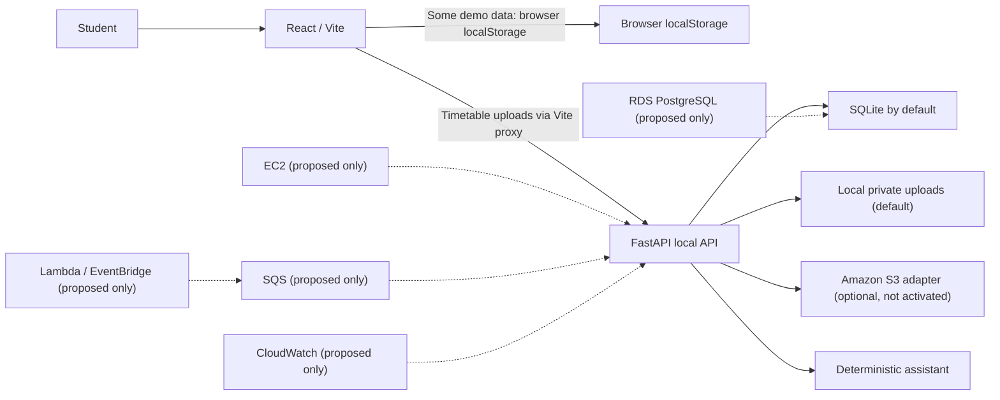

# UniTask AI

UniTask AI is an academic productivity workspace for bringing university assignments, deadlines and planning into one place. The product requirements are documented in [docs/MASTER_PROJECT_BRIEF.md](docs/MASTER_PROJECT_BRIEF.md); current architecture decisions and implementation progress are in the `docs/` folder.

## Current status

The frontend is demonstration-ready. Assignments and subjects currently persist in browser `localStorage`; the timetable upload screen is connected to the local FastAPI API. The backend also has SQLite-backed assignment/subject APIs and a deterministic assistant endpoint, but most frontend assignment screens still use the local browser store rather than those API endpoints. There is no authentication or user isolation. No AWS resources are deployed, and S3 remains optional and disabled by default.

## Run the frontend

Requirements: Node.js and npm.

```powershell
cd frontend
npm install
npm run dev
```

Open the local URL printed by Vite (normally `http://localhost:5173`). Demo records are stored in this browser's localStorage. To verify the production bundle and lint:

```powershell
npm run build
npm run lint
```

## Project layout

- `frontend/` — React, TypeScript and Vite application.
- `backend/` — pinned Python dependencies; application code is planned for a later milestone.
- `docs/MASTER_PROJECT_BRIEF.md` — authoritative product specification.
- `docs/ARCHITECTURE_DECISIONS.md` — audit and architecture decisions.
- `docs/IMPLEMENTATION_PROGRESS.md` — milestone and validation status.

No AWS credentials or services are needed to run the current frontend.

## Demo feature boundaries

- **Working locally:** assignment add/edit/delete/complete, subject add/edit/delete, deadline calendar, derived dashboard counts, deterministic assignment assistant, CSV/JSON assignment import.
- **Preview only:** timetable image selection. No OCR or extraction.
- **Not connected:** sign-in, backend, cloud persistence, external LMS platforms, and an LLM API.
- Use **Settings → Reset demo data** to restore initial records.

CSV import requires `title,subjectCode,dueDate` columns; `platform` is optional. Due dates use `YYYY-MM-DD`, and subject codes must match a subject in the workspace. JSON imports use an array of objects with `title`, `subjectCode`, and `dueDate` fields.

## Backend and timetable upload

In a second PowerShell terminal:

```powershell
Set-Location 'C:\Users\Rithish\Desktop\UniTask-AI\backend'
.\.venv\Scripts\Activate.ps1
uvicorn main:app --reload
```

Start the frontend with `npm run dev` from `frontend/`. Vite proxies `/api` requests to the local API at `http://127.0.0.1:8000`. API documentation is at `http://127.0.0.1:8000/docs`.

Timetable image uploads accept JPEG, PNG, or WebP up to 5 MB. The backend checks the filename extension, declared content type, file signature, and size. The default provider stores private files under `backend/uploads/` and metadata in the configured SQLAlchemy database. There is no OCR or extraction. The upload endpoints are currently unauthenticated and intended for local development only; do not expose this API publicly.

## Optional S3 adapter — not deployed

`backend/app/storage.py` implements local and S3 storage providers. Local remains the default. S3 objects use unique keys, no public ACL, and short-lived presigned retrieval URLs. The backend reads its ignored `backend/.env` file; the prepared configuration keeps local storage active and includes the intended S3 profile and bucket settings. Boto3 uses the configured `AWS_PROFILE=unitask-demo`. No credentials belong in React, `.env`, or source control.

The configured AWS CLI profile was verified as `arn:aws:iam::687159379583:user/unitask-demo-s3`. The bucket's ownership controls, all four Block Public Access settings, and AES256 default encryption were read back and verified. AWS denied separate reads of the bucket policy status and ACL; the verified full Block Public Access configuration prevents public ACL access and blocks/restricts public bucket policies. The local backend `.env` selects the S3 adapter with the intended bucket, region, and profile; local storage remains the application default if `STORAGE_PROVIDER` is unset. One explicitly approved test image was uploaded through FastAPI and retrieved from S3 with its presigned URL; the retrieved bytes matched. A regional endpoint issue discovered during that test was fixed, and a regression test was added. The test object remains in the bucket. See [docs/AWS_S3_DEMO_GUIDE.md](docs/AWS_S3_DEMO_GUIDE.md). The account plan, Free Tier eligibility, S3 allowance, and costs were not independently verified. Free Tier eligibility, credits, requests, storage, transfer, taxes, and offer expiration can vary by account and may still result in charges.

See [docs/AWS_S3_DEMO_GUIDE.md](docs/AWS_S3_DEMO_GUIDE.md) for the reviewed preflight, proposed bucket setup commands, local environment configuration, upload and retrieval walkthrough, verification, and cleanup.

To check account eligibility manually, sign in to the AWS Console and inspect:

1. **Billing and Cost Management → Free Tier** for the account plan, exact offer eligibility, usage limits, and expiry.
2. **Billing and Cost Management → Bills** for current charges and taxes.
3. **Billing and Cost Management → Cost Explorer** for recent service usage, if enabled.
4. **AWS account menu → Account** to review the account plan and billing configuration.

Until these account-specific details are confirmed, use the local storage provider. If the AWS CLI is later installed and account access keys are set up, configure the profile only in the local terminal using `aws configure --profile unitask-demo`; never paste credentials into chat or commit them.

`backend/requirements-aws.txt` includes the existing pinned backend requirements plus Boto3 for the optional adapter. Install only when enabling/testing that adapter:

```powershell
Set-Location 'C:\Users\Rithish\Desktop\UniTask-AI\backend'
.\.venv\Scripts\Activate.ps1
pip install -r requirements-aws.txt
```

Then use environment variables (not frontend variables):

```powershell
$env:STORAGE_PROVIDER = 's3'
$env:S3_BUCKET = '<approved-private-bucket-name>'
$env:AWS_REGION = 'ap-south-1'
$env:AWS_PROFILE = 'unitask-demo'
```

The S3 adapter is not tested against AWS; real upload requires an approved private bucket and IAM permissions.

## Architecture and deployment status



Local FastAPI, SQLite, and local file storage are implemented. S3 is optional code only, with no bucket configured or deployed. EC2, RDS, SQS, Lambda, EventBridge, and CloudWatch are proposals, not deployed infrastructure. No AWS resource creation or deployment is authorized by this setup.
